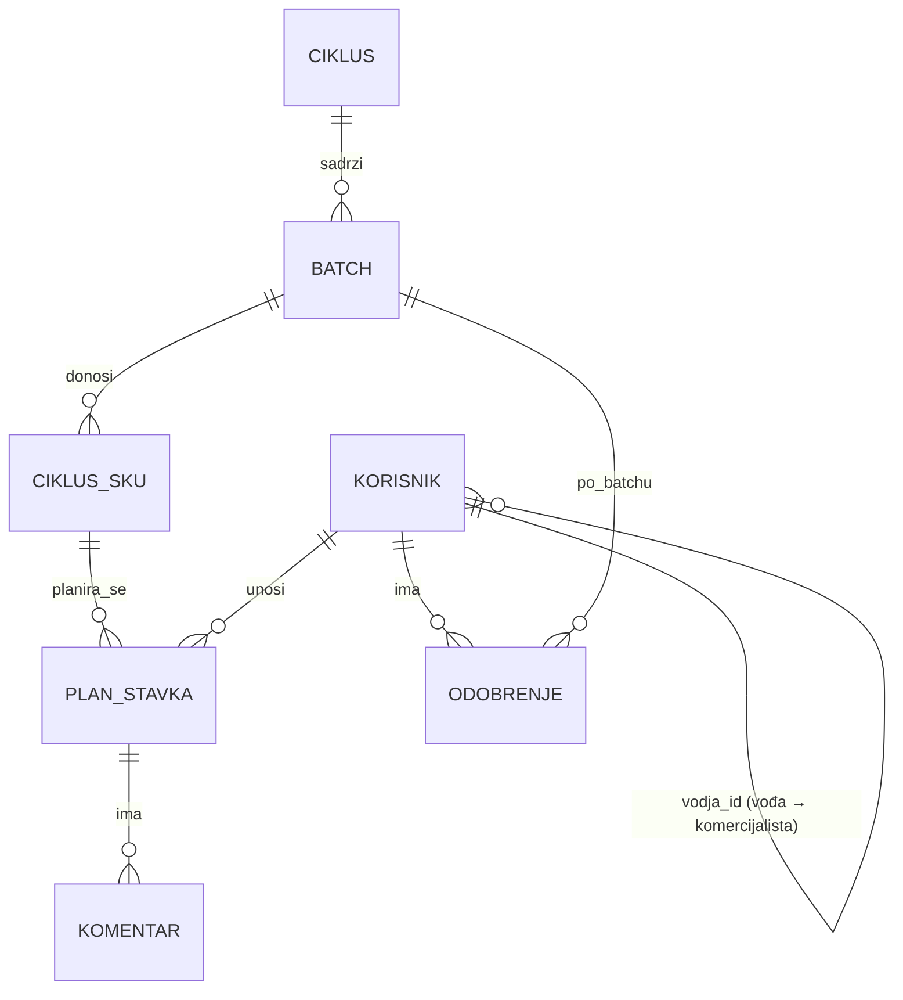
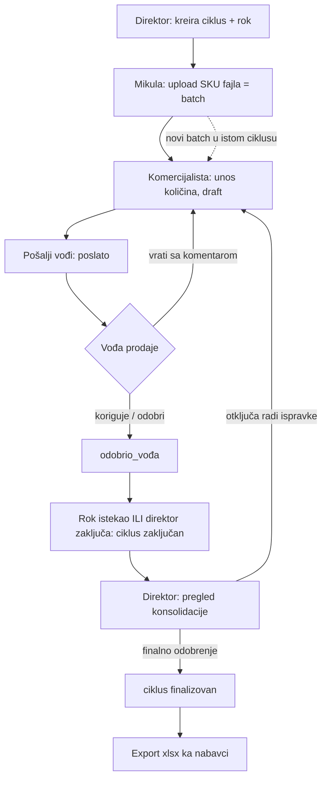

# Spec – Alat za robno planiranje (Textil)

Sep 26, 2026 · @Djordje

## 1. Kontekst i cilj

Alat zamenjuje razmenu Excel tabela između nabavke i prodaje jednim mestom gde se plan prodaje unosi, odobrava i vraća nabavci u fiksnom formatu.

Nabavka (Mikula) iz svog Excel alata izvozi listu SKU sa mesecima. 12 komercijalista unosi planiranu količinu po SKU i mesecu. Vođe prodaje pregledaju i odobravaju planove svojih ljudi, direktor prodaje daje finalno odobrenje. Konsolidovan plan (SKU × mesec + total) se izvozi nazad u Mikulin alat, koji dalje računa nabavku.

**U obimu:** import SKU liste, unos plana, dvostepeno odobravanje, zaključavanje po roku, istorija slanja, konsolidacija i export.

**Van obima:** preračun nabavke (ostaje u Mikulinom Excelu), veza sa ERP-om, veza sa B2B platformom. Alat je standalone aplikacija — B2B tim ga ne razvija. Obim: 3–4 ciklusa godišnje, 50–500 SKU po ciklusu, oko 15 korisnika.

**Nije rešeno u ovoj verziji:** prikaz istorije prodaje ili zaliha uz SKU kao pomoć pri planiranju — zahteva ERP pristup, ostavljeno za kasniju fazu.

## 2. Uloge i hijerarhija

Četiri uloge; jedan korisnik može imati više njih (vođa prodaje je istovremeno i komercijalista sa sopstvenim planom).

| Uloga | Ko | Šta radi u alatu |
| --- | --- | --- |
| Nabavka | Mikula | Uploaduje SKU fajlove u otvoren ciklus, preuzima finalni export, vidi status ciklusa |
| Komercijalista | 12 osoba | Unosi količine po SKU × mesec za svoju bazu kupaca, šalje plan vođi, vidi vraćene korekcije i komentare |
| Vođa prodaje | vođe timova (3–4 komercijalista po vođi) | Pregleda planove svog tima, koriguje količine ili vraća sa komentarom, odobrava; pravi i svoj plan |
| Direktor prodaje | 1 osoba | Otvara ciklus i postavlja rok, vidi sve (zbirno i po prodavcu), zaključava ciklus, daje finalno odobrenje |

**Hijerarhija** se čuva kao konfiguracija: `vođa → [komercijalisti]`. Direktor je iznad svih vođa. Planove samih vođa odobrava direktor, u istom koraku kao finalni pregled.

Uloge se dodeljuju u administraciji alata; nema samoregistracije. Autentifikacija: email + lozinka, bez SSO u prvoj verziji.

## 3. Model podataka

Sve se vrti oko ciklusa: rok i zaključavanje žive na ciklusu, slanja SKU su batch-evi unutar njega, a plan je jedna tabela komercijalista × SKU × mesec.



| Entitet | Ključna polja | Napomena |
| --- | --- | --- |
| Korisnik | id, ime, email, uloge\[\], vodja\_id | vodja\_id = kome šalje plan na odobrenje; null za direktora |
| Ciklus | id, naziv, meseci\[\] (YYYY-MM), rok, status, kreirao, datum | Direktor kreira. Meseci se preuzimaju iz prvog uploadovanog fajla. Status: otvoren / zaključan / finalizovan |
| Batch | id, ciklus\_id, redni\_broj, uploadovao, datum, izvorni\_fajl | Jedno Mikulino slanje. Čuva originalni xlsx radi istorije |
| Ciklus\_SKU | id, ciklus\_id, batch\_id, sifra | Jedinstveno po (ciklus\_id, sifra). Samo šifra, bez naziva — svi rade sa šifrom. Prodaja ne može da menja ni briše |
| Plan\_stavka | id, ciklus\_sku\_id, korisnik\_id, mesec, kolicina, kolicina\_korigovano?, korigovao?, korigovano\_kad? | Jedinstveno po (ciklus\_sku\_id, korisnik\_id, mesec). Prazno = 0. Važeća vrednost = korigovano ako postoji, inače kolicina |
| Odobrenje | id, batch\_id, korisnik\_id, status, promenio, datum, komentar | Status po (komercijalista, batch): draft / poslato / vraćeno / odobrio\_vođa. Novi batch ne dira odobrenja starih |
| Komentar | id, plan\_stavka\_id, autor, tekst, datum | Vezan za konkretan SKU × mesec ("da li si siguran za mart?") |
| Audit\_log | id, entitet, entitet\_id, akcija, ko, kad, staro, novo | Svaka promena količine, statusa i uploada |

**Konsolidacija** nije poseban entitet: `SUM(važeća količina) GROUP BY sifra, mesec` po ciklusu, plus total po SKU. Uvek je moguće razbiti zbir po komercijalisti.

## 4. Tok procesa i statusi

Ciklus prolazi kroz tri statusa; unutar otvorenog ciklusa svaki batch ima svoj tok odobravanja po komercijalisti.



**Statusi ciklusa**

| Status | Ko prelazi | Šta je dozvoljeno |
| --- | --- | --- |
| otvoren | direktor kreira | upload batch-eva, unos i odobravanje planova |
| zaključan | automatski po roku ili direktor ručno | nikakav unos; direktor pregleda konsolidaciju; može da otključa |
| finalizovan | direktor | samo čitanje i export; ne može nazad |

**Statusi odobrenja** (po komercijalisti, po batch-u)

| Status | Ko prelazi | Značenje |
| --- | --- | --- |
| draft | automatski pri kreiranju batch-a | komercijalista unosi, vođa ne vidi kao završeno |
| poslato | komercijalista | zaključan za komercijalistu, čeka vođu |
| vraćeno | vođa | otvoren za komercijalistu, sa komentarima |
| odobrio\_vođa | vođa | ulazi u konsolidaciju |

Kad Mikula pošalje drugi batch, odobrenja za prvi ostaju netaknuta; komercijalista dobija samo nove SKU u statusu draft. Nepopunjen ili neposlat plan pri zaključavanju ulazi u konsolidaciju kao 0 i vidljivo je označen na dashboardu direktora.

## 5. Matrica uloga × akcija × status

Sva pravila se sprovode na backendu (API), ne samo sakrivanjem dugmića u interfejsu.

| Akcija | Nabavka | Komercijalista | Vođa prodaje | Direktor | Dozvoljeno u statusu ciklusa |
| --- | --- | --- | --- | --- | --- |
| Kreiraj ciklus, postavi/promeni rok | – | – | – | da | – |
| Upload SKU fajla (novi batch) | da | – | – | – | otvoren |
| Vidi listu SKU u ciklusu | da | samo poslate | tim + svoje | sve | svi |
| Izmeni / obriši SKU | – | – | – | – | nikad (samo kroz novi batch) |
| Unos / izmena količina | – | svoje, dok je draft ili vraćeno | svoje + tima (korekcija) | – | otvoren |
| Pošalji plan vođi | – | da | da (svoj plan) | – | otvoren |
| Vrati plan sa komentarom | – | – | tim | tim + vođe | otvoren |
| Odobri plan (nivo vođe) | – | – | tim | vođe | otvoren |
| Vidi konsolidaciju | zbirno, posle finalizacije | – | svoj tim | zbirno + po prodavcu | svi |
| Zaključaj / otključaj ciklus | – | – | – | da | otvoren ↔ zaključan |
| Finalno odobrenje | – | – | – | da | zaključan → finalizovan |
| Export finalnog plana | da | – | – | da | finalizovan |
| Vidi istoriju batch-eva | da | – | da | da | svi |
| Vidi audit log | – | – | – | da | svi |
| Administracija korisnika i hijerarhije | – | – | – | da | – |

Komercijalista vidi samo sopstveni plan, nikad kolege. Vođa vidi svoj tim i sebe. Direktor i nabavka nikad ne unose količine.

## 6. Format razmene sa nabavkom

Oba smera koriste isti oblik tabele: prva kolona SKU, zatim po jedna kolona po mesecu. Ulaz je prazan, izlaz popunjen, sa dodatnom kolonom Total.

**Ulazni fajl (Mikula → alat)**

Xlsx, jedan sheet, prvi red zaglavlje. Meseci u zaglavlju određuju period ciklusa (samo iz prvog batch-a; naredni moraju da se poklope).

```csv
SKU,2027-01,2027-02,2027-03,2027-04,2027-05,2027-06
TX-10231,,,,,,
TX-10232,,,,,,
TX-10555,,,,,,
```

Mesec u zaglavlju je uvek u formatu `YYYY-MM`. Fajl nema kolonu sa nazivom artikla — komercijalisti, kao i Mikula, rade sa šifrom.

**Izlazni fajl (alat → Mikula)**

Xlsx sa dva sheet-a:

1. `Plan` — konsolidacija: SKU, kolona po mesecu, Total. Redosled SKU isti kao pri uploadu.
2. `Po prodavcu` — iste kolone plus `Prodavac`; po red za svaki par SKU × prodavac koji ima količinu > 0.

```csv
SKU,2027-01,2027-02,2027-03,2027-04,2027-05,2027-06,Total
TX-10231,1200,1500,1500,900,600,300,6000
TX-10232,0,0,800,800,400,0,2000
TX-10555,0,0,0,0,0,0,0
```

SKU bez ijedne količine ostaju u fajlu sa nulama — Mikula treba da vidi da ih je poslao, a niko nije planirao. Export uvek uključuje sve SKU iz svih batch-eva ciklusa.

Fajl nosi u nazivu ciklus i datum exporta, npr. `Plan-2027_final_2026-11-15.xlsx`.

## 7. Pravila i validacije

Pravila su jednostavna, ali se sva sprovode na serveru — Excel navike (ručno prepravljanje, brisanje redova) alat ne dozvoljava.

**Import fajla**

- Duplikat šifre unutar istog fajla ili već postojeće u ciklusu → preskoči i prikaži upozorenje sa listom; import se ne prekida.
- Meseci u zaglavlju različiti od meseci ciklusa → import odbijen sa porukom koji meseci nedostaju/viškaju.
- Prazna šifra ili prazan fajl → odbijeno.
- Originalni fajl se čuva uz batch.

**Unos količina**

- Ceo broj ≥ 0; prazno polje = 0.
- Jedinica mere je ona iz Mikulinog alata; alat ne konvertuje.
- Automatsko čuvanje pri svakoj promeni ćelije (nema "sačuvaj" dugmeta koje se zaboravi).
- Posle "pošalji vođi" komercijalista ne može da menja dok mu vođa ne vrati.

**Odobravanje**

- Vođa može da promeni količinu; originalni unos komercijaliste ostaje vidljiv (precrtan ili u tooltipu) uz ime i vreme korekcije.
- Vraćanje plana zahteva bar jedan komentar.
- Vođa ne može da odobri sopstveni plan; planove vođa odobrava direktor.

**Rok i zaključavanje**

- Rok je datum + vreme; u trenutku isteka ciklus automatski prelazi u zaključan.
- Direktor može da otključa ciklus; svako otključavanje/zaključavanje ide u audit log.
- Promena roka je moguća samo dok je ciklus otvoren.
- Neposlati planovi pri zaključavanju ostaju u statusu u kom su bili i ulaze u konsolidaciju sa važećim vrednostima (draft vrednosti se računaju, ne nule).

**Finalizacija i export**

- Finalizacija je nepovratna; ispravka posle toga = novi ciklus.
- Export je dostupan samo za finalizovan ciklus; svaki export se beleži (ko, kad).

**Obaveštenja** (email, prva verzija)

- Komercijalisti: novi batch stigao; plan vraćen; rok za 2 dana.
- Vođi: komercijalista poslao plan.
- Direktoru: svi planovi tima odobreni; ciklus zaključan.
- Mikuli: ciklus finalizovan, export spreman.

## 8. Odluke sa Textilom

Sva pitanja iz prvog kruga su odgovorena (Textil, 26.9.2026); sekcije 1–7 su ažurirane prema odlukama.

| # | Pitanje | Odluka |
| --- | --- | --- |
| 1 | Ko odobrava plan samog vođe prodaje? | Direktor, u istom koraku kao finalni pregled |
| 2 | Naziv artikla uz šifru? | Ne — samo šifra, kao u Mikulinom alatu |
| 3 | Format meseca u zaglavlju | `YYYY-MM` |
| 4 | Dodatni batch sa drugačijim mesecima | Greška; svi fajlovi u ciklusu imaju iste mesece |
| 5 | Neposlat plan pri zaključavanju | Draft vrednosti se računaju, uz oznaku "nije poslato" |
| 6 | Vođa i tuđi tim | Vidi i koriguje samo svoj tim |
| 7 | Hijerarhija vođa → komercijalisti | Postoji u firmi; za razvoj se koriste test nalozi (ispod) |
| 8 | Obim | 3–4 ciklusa godišnje, 50–500 SKU po ciklusu |
| 9 | Međuizvoz pre finalizacije | Ne u prvoj verziji |
| 10 | Vlasnik alata posle isporuke | Textil hostuje, Djordje održava po pozivu |

**Test nalozi za razvoj:** Tijana (komercijalista), Milan (vođa prodaje, Tijanin vođa), Pop (direktor prodaje), Mikula (nabavka). Pravi spisak korisnika i hijerarhija se unose pre produkcije.

- [x] Poslati direktoru prodaje i Mikuli na pregled
- [x] Uneti odgovore i zaključati spec
- [ ] Procena obima i vremena razvoja
- [ ] Pravi spisak korisnika i hijerarhija pre produkcije
